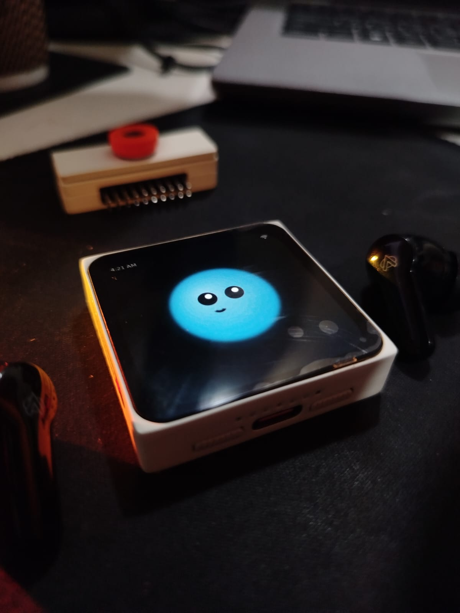
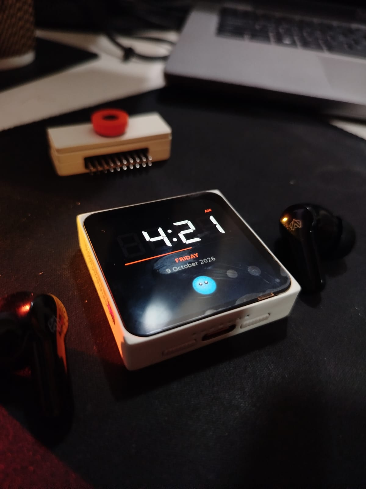
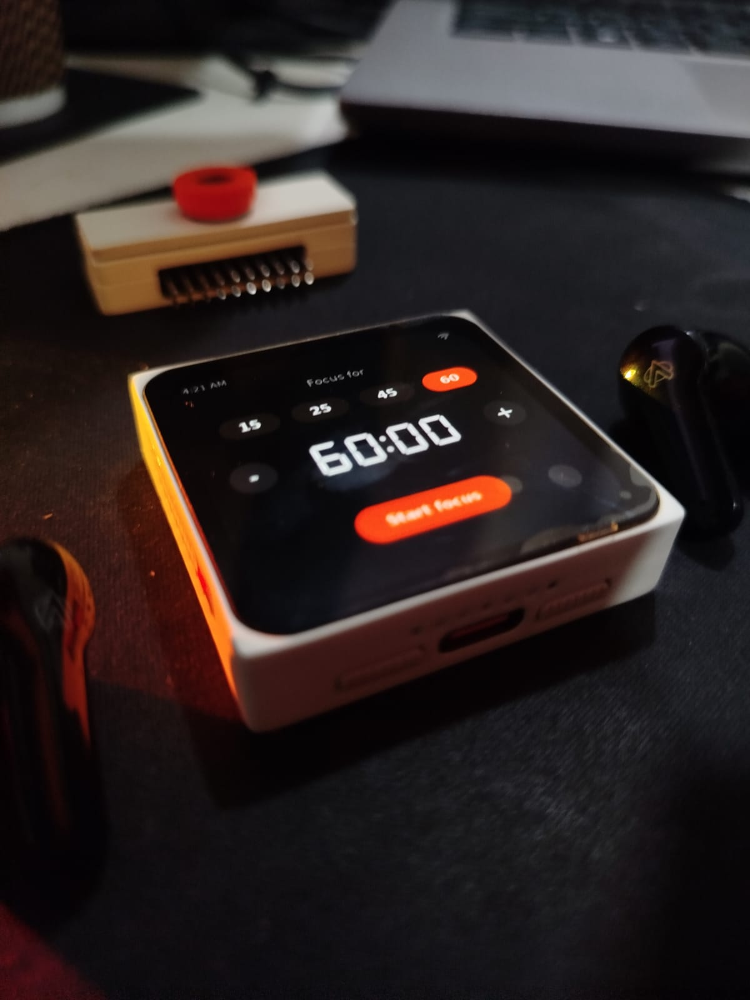
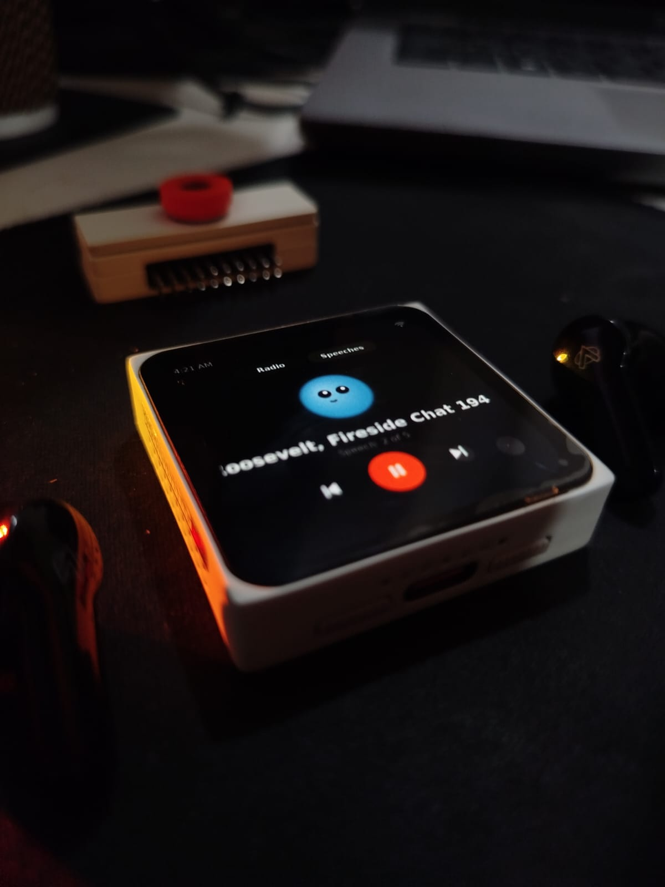
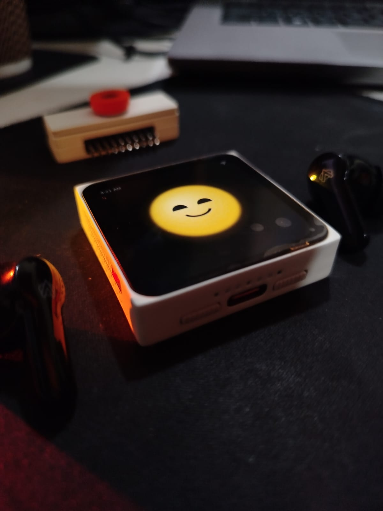
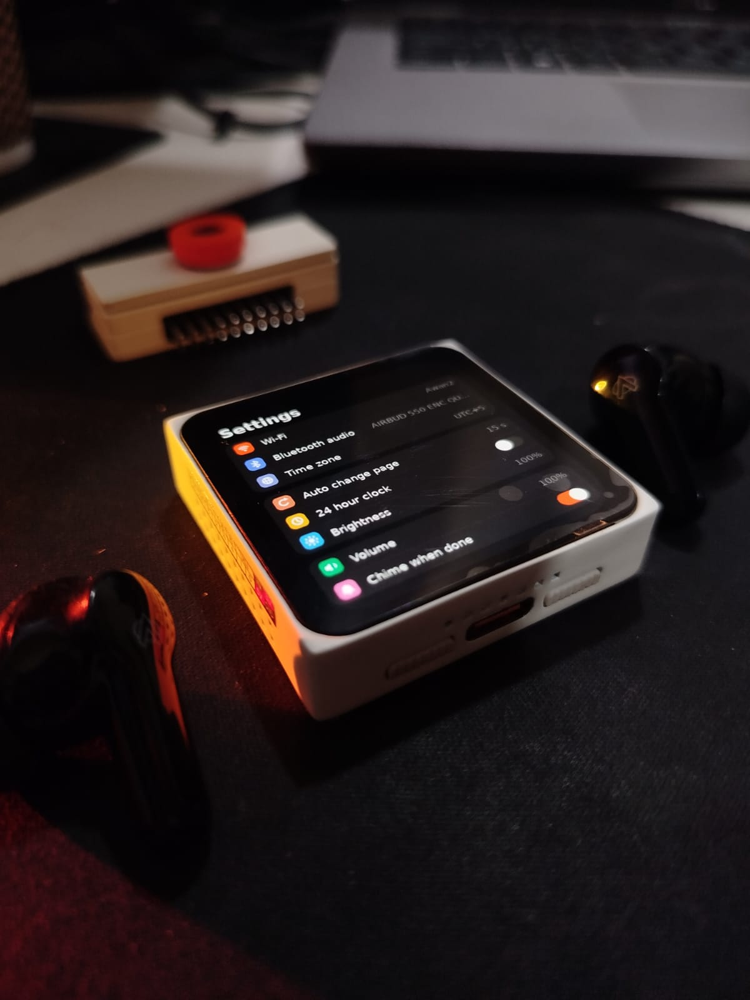
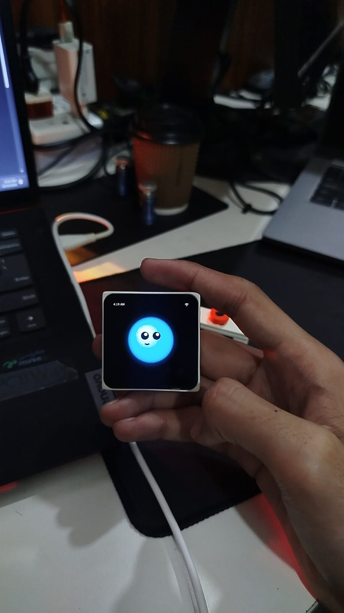
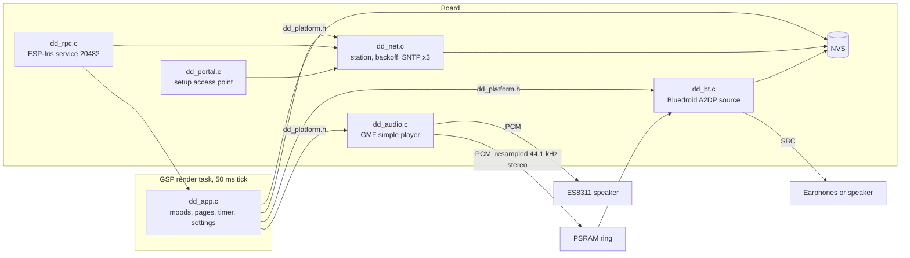
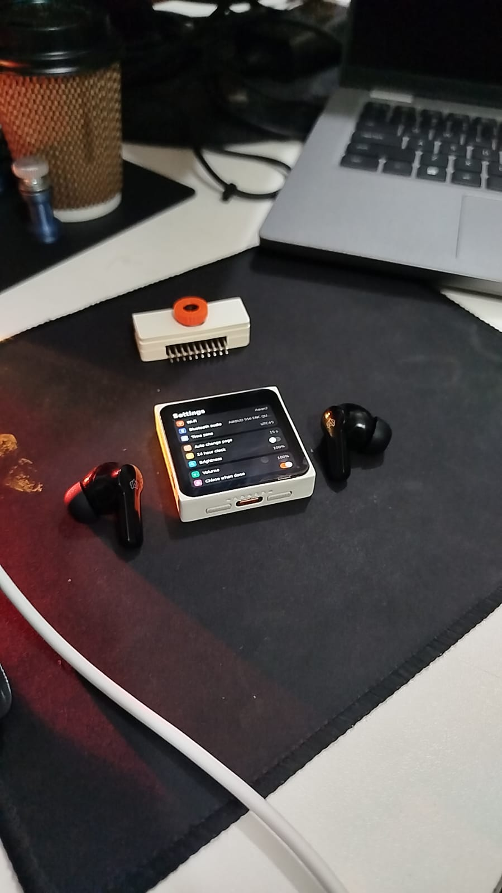
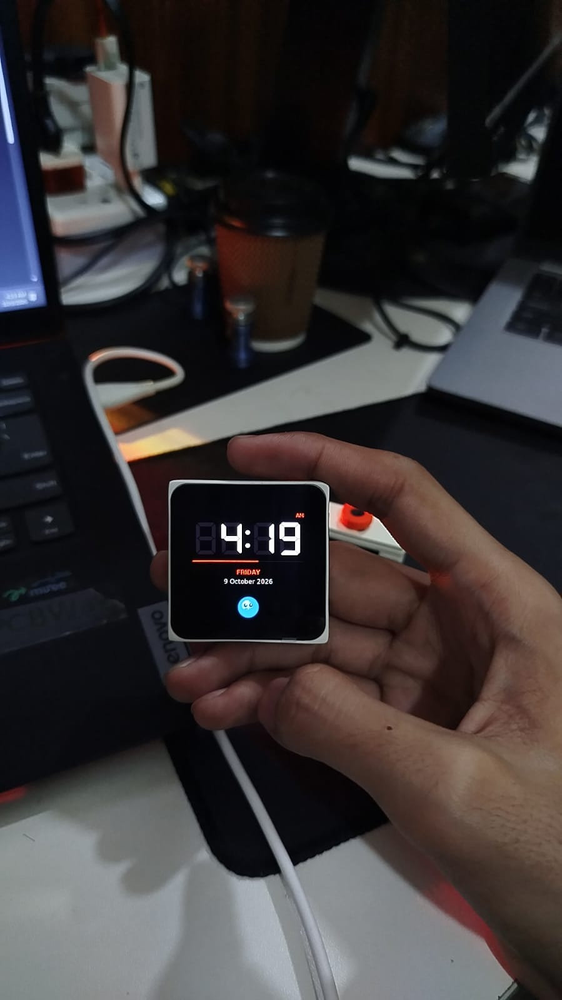

<div align="center">



# Dilly-dally

**A desk companion that refuses to sit still.**

A face that blinks, drifts and sulks. A seven segment clock. A focus timer that
watches you work. Internet radio, old speeches, and Bluetooth audio out to
whatever is in your ears. One ESP32-S31, one 480 by 480 AMOLED, zero wires
beyond power.

[](https://mosaico.espressif.com/)
[](https://github.com/espressif/esp-idf)
[](#bluetooth-audio)
[](LICENSE)

[](https://mosaico-ideas.espressif.com/)
[](https://www.instagram.com/hackhobby_lab/)

</div>

<br>

<div align="center">

| 5 | 10 | 60 | 9 | 5 | 50 ms | 0 |
| :---: | :---: | :---: | :---: | :---: | :---: | :---: |
| pages | moods | face frames | radio stations | speeches | render tick | credentials compiled in |

</div>

<br>

<div align="center">
<table>
  <tr>
    <td align="center"><br><sub><b>Clock</b><br>SNTP time, ghost segments, a seconds hairline</sub></td>
    <td align="center"><br><sub><b>Focus</b><br>Presets or your own length, five to 180 minutes</sub></td>
    <td align="center"><br><sub><b>Listen</b><br>Nine stations and five speeches, streamed</sub></td>
  </tr>
  <tr>
    <td align="center"><br><sub><b>Poke it</b><br>It notices. Poke it four times and it blushes</sub></td>
    <td align="center"><br><sub><b>Settings</b><br>Wifi, Bluetooth, time zone, brightness, volume</sub></td>
    <td align="center"><br><sub><b>Palm sized</b><br>Core board only, nothing to attach</sub></td>
  </tr>
</table>
</div>

## Contents

1. [What it does](#what-it-does)
2. [The face](#the-face)
3. [Under the hood](#under-the-hood)
4. [Things that were not obvious](#things-that-were-not-obvious)
5. [Run it without building](#run-it-without-building)
6. [First boot](#first-boot)
7. [Bluetooth audio](#bluetooth-audio)
8. [Settings](#settings)
9. [Build from source](#build-from-source)
10. [Driving it over RPC](#driving-it-over-rpc)
11. [How the code is laid out](#how-the-code-is-laid-out)
12. [Troubleshooting](#troubleshooting)
13. [Where else to find this](#where-else-to-find-this)
14. [Licence](#licence)

## What it does

Five pages. Swipe between them, or set an interval and let face and clock take
turns on their own while nobody is touching it.

| Page | What lives there |
| --- | --- |
| **Face** | A glowing orb with a mood. Blinks on its own clock, bobs on another, reacts to touch |
| **Clock** | Seven segment time in DSEG7, day, date, and a small face keeping you company |
| **Focus** | Pick 15, 25, 45 or 60 minutes or step your own. Start, pause, stop. A chime at the end |
| **Listen** | Radio and speeches over HTTP and HTTPS, decoded on the board, out the speaker or Bluetooth |
| **Settings** | Eight rows in three cards. Every change lands in NVS when its sheet closes |

Black everywhere. The AMOLED switches off every pixel that is not drawing
anything, so the orb floats on nothing. Accent is Mosaico orange `#FF4C01`. The
idle face wears clay `#D97757`.

## The face

The face is the whole point. A clock that sits perfectly still is furniture.
This one never sits perfectly still.

Ten moods, each an orb in its own colour with its own eyes and mouth. Every
mood is rendered at three sizes with eyes open and mid blink. Sixty frames,
all baked at build time by `ui/face_art.py`, all held decoded in PSRAM so a
mood change never waits on a JPEG.

<div align="center">

| What happens | What the face does | For how long |
| --- | --- | --- |
| Nothing | Idles in clay, breathing | Until something happens |
| Nothing, for a minute or two | Daydreams a passing expression | 3 s |
| Nothing, for ten minutes | Gets bored | Until touched |
| A poke | Lights up | 2.5 s |
| Four pokes inside three seconds | Blushes | 3.5 s |
| Audio playing | Goes dreamy | While it plays |
| A stream fails | Pulls a face | 5 s |
| Last minute of a focus run | Gets anxious | 60 s |
| Focus paused over two minutes | Gets worried | Until resumed |
| Focus stopped early | Gets cross | 5 s |
| Focus finished | Celebrates | 10 s |
| Wifi gone over thirty seconds | Gets sad | Until it is back |

</div>

Blinks land every 2.2 to 6.4 seconds, one in five of them a double. The bob is
a 3.2 second sine, six pixels each way, only while the big face is on screen.
The two clocks never line up, so the motion never loops.

None of the mood names ever reach the screen. Internally they are blip,
sunny, meh, drizzle, jitter, wobble, grump, ick, sparkle and blush.

## Under the hood



The UI never touches a driver. Everything it needs from the board goes
through `main/dd_platform.h`, a dozen calls wide. The board implements it in
`dd_platform_esp.c`. The simulator implements it in `pc/platform_pc.c` with a
pretend radio and a pretend Bluetooth that finds two speakers. Same C, same
scene, both ends.

| Layer | What it is |
| --- | --- |
| Display | 480 by 480 AMOLED, CO5300 over QSPI, tear effect on |
| UI | ESP-GSP 1.5.1. Scene JSON generated by `ui/build_scene.py`, compiled to a resource partition |
| Faces | 60 JPEG frames, hardware decoded, 7 MB decoded image cache in PSRAM |
| Clock font | DSEG7 Classic Bold at 112 px, with an unlit `88:88` drawn behind it |
| Time | SNTP against three servers at once, time zone in half hour steps |
| Audio | ESP-GMF simple player, MP3 streams, TLS certificate bundle for HTTPS |
| Bluetooth | Bluedroid on core 1, Classic A2DP source, SBC 44.1 kHz joint stereo, bitpool up to 53 |
| Control | ESP-Iris RPC, five methods on service 20482 |
| Storage | One versioned NVS blob for settings, one key for the remembered speaker |

## Things that were not obvious

Every one of these cost real time. The comments in the code carry the detail.

**The hardware JPEG decoder shifts the colour range.** Faces came out washed
grey with a lifted black. The output follows `(in - 16) * 255 / 219`, a video
range expansion. The build bakes two face sets. The board gets one with the
inverse applied, the simulator gets the true one.

**The Bluetooth controller defaults to BLE only.** Classic enable then waits
forever on an HCI reset that never answers, and `esp_bluedroid_enable()` hangs.
`sdkconfig.defaults` sets BR/EDR only. Bluetooth also starts on its own task
now, so a stuck stack can never hold the screen hostage again.

**The Bluetooth stack costs about 90 KB of internal RAM.** So it stays down
until you press Search, or until boot finds a remembered speaker.

**archive.org redirects every download to an HTTPS mirror.** The HTTP reader
followed the redirect but kept the plain socket. `dd_audio.c` resolves the
redirect chain with HEAD requests first and hands the player the final URL.

**An empty label draws a question mark.** And the setter times out. Blank
labels get a single space.

**Setters made before the first frame overflow the UI queue.** Every initial
value is drawn from the first tick instead of from `app_main`.

**A toggle moves its knob but keeps its authored track colour.** So a switch
that boots off still glowed orange. The app sets the track colour itself.

**One SNTP server took 80 seconds to answer on a slow network.** Three servers
queried together bring it to about twenty.

## Run it without building

A prebuilt bundle ships in `prebuilt/`. No ESP-IDF, no toolchain, no compiler.
Run this from a Vibe workspace root with the board on USB.

```powershell
.\m.ps1 iris system-update --bundle path\to\prebuilt\dillydally-1.0.0-system-update.irisfw
```

It writes the application and the UI resources, then validates both. There is
a SHA256 to check against in `prebuilt/README.md`. Vibe Mode lives in the
`factory` partition and is left alone, so you always have a way back.

## First boot

Nothing secret is compiled in. The clock needs a 2.4 GHz network with a route
to the internet for time, and the radio needs it for everything.

The easy way is the board's own access point. Settings, then Wi-Fi. The board
raises a network and shows its name and password on screen. Join it, open
`192.168.4.1`, pick your network.

Or over RPC, from the workspace root.

```powershell
.\m.ps1 iris rpc 20482 1 --payload "ssid=YOUR_WIFI_NAME"
.\m.ps1 iris rpc 20482 1 --payload "pass=YOUR_WIFI_PASSWORD"
.\m.ps1 iris rpc 20482 2
```

Method 2 answers with a status line in JSON and never prints the password
back. Once `up` and `time` both read true the clock is live.

## Bluetooth audio

<div align="center">

</div>

<br>

Settings, then Bluetooth audio. Put your earbuds or speaker in pairing mode
first. The sheet searches for about ten seconds and lists up to four audio
devices by name. Tap one.

From then on radio, speeches and the chime all go to it instead of the board's
speaker. Volume follows the Volume setting. Disconnect sends sound back to the
speaker and forgets the device. Otherwise it is remembered, and the board
reconnects to it at boot.

Classic Bluetooth, A2DP, SBC. That is what nearly every pair of earbuds,
AirPods included, and nearly every speaker still speaks for music. Decoded audio
of any rate is resampled to 44.1 kHz stereo on the way into a PSRAM ring, and
the A2DP callback pads with silence when the stream runs dry rather than
glitching.

## Settings

Three cards, eight rows. Tap a row to change it. Toggles flip in place.

| Row | Does | Default |
| --- | --- | --- |
| Wi-Fi | Shows the network, raises the setup access point | none |
| Bluetooth audio | Search, connect, disconnect | off |
| Time zone | UTC offset in half hour steps, minus 12 to plus 14 | `UTC+5` |
| Auto change page | Swap face and clock every 15 s, 30 s, 1 min or 5 min | off |
| 24 hour clock | Toggle | off |
| Brightness | Panel brightness | 80 |
| Volume | Speaker or Bluetooth | 60 |
| Chime when done | Toggle | on |

The last focus length is remembered too.

## Build from source

Clone this into a Vibe workspace as `projects/dillydally`. Then from the
workspace root

```powershell
.\m.ps1 iris system-update --project projects/dillydally
```

Use `system-update`. It carries the partition table and the UI resources along
with the code, so a change to the scene or the faces always lands.

The art and the screen are generated, not drawn by hand. Edit the Python, run
it, rebuild.

```powershell
cd ui
python face_art.py      # faces and icons, both colour sets
python build_scene.py   # main.json, main_sim.json, ../main/dd_faces_gen.h
```

The simulator runs the very same C against the same scene on a PC.

```powershell
.\m.ps1 project sim --project projects/dillydally --interactive
```

`pc/sim_walkthrough.py` drives every page, every editor and the Bluetooth
sheet through the simulator API and fails on the first setter error.

## Driving it over RPC

Everything you can tap, you can script. Service 20482.

| Method | Payload | Does |
| --- | --- | --- |
| 1 | `ssid=NAME` or `pass=PASSWORD` | Store wifi credentials and reconnect |
| 2 | none | Status JSON. Network, time, audio, last UI error |
| 3 | `0` to `4` | Go to a page. Face, clock, focus, listen, settings |
| 4 | an index, a URL, or `stop` | Play a station or speech, or any MP3 URL |
| 5 | `status`, `search`, `off`, or an index | Drive Bluetooth |

```powershell
.\m.ps1 iris rpc 20482 4 --payload "0"        # Groove Salad
.\m.ps1 iris rpc 20482 5 --payload "search"
.\m.ps1 iris rpc 20482 5 --payload "status"
.\m.ps1 iris rpc 20482 5 --payload "0"        # connect to the first one found
```

## How the code is laid out

| File | What lives there |
| --- | --- |
| `main/dd_app.c` | Moods, blinking, pages, clock, focus timer, audio UI, settings, Bluetooth sheet |
| `main/dd_platform.h` | The seam between the UI and the board |
| `main/dd_platform_esp.c` | That seam on the board. NVS settings, brightness, routing |
| `main/dd_net.c` | Station with backoff reconnect, SNTP, access point helpers |
| `main/dd_portal.c` | The setup access point and its web form |
| `main/dd_audio.c` | Player task, redirect resolver, chime, PCM routing |
| `main/dd_bt.c` | Bluedroid bring up, discovery, A2DP source, resampler, ring |
| `main/dd_media.c` | The station and speech list |
| `main/dd_rpc.c` | The ESP-Iris RPC service on 20482 |
| `ui/face_art.py` | Renders every face frame and icon |
| `ui/build_scene.py` | Generates the scene and the face table |
| `pc/` | Simulator backend and the walkthrough test |

## Troubleshooting

**The clock says Waiting for the time.** The board is on a network but cannot
reach a time server. Check the network has internet, not just a signal. Phone
hotspots with no data plan look exactly like this.

**Radio says it cannot connect.** Same cause nine times in ten. Method 2 over
RPC shows `up` and `time`. If both are true, the station itself may be down.
Try the next one.

**Bluetooth finds nothing.** The device has to be in pairing mode, not just
switched on. Earbuds already paired to a phone usually need to come out of the
case with the phone's Bluetooth off.

**The board is unreachable.** Hold the AI button on GPIO7 while powering on to
boot back into Vibe Mode.

## Where else to find this

Flash it from the Mosaico Ideas gallery and skip the clone entirely. Build
photos, the bits that did not work, and whatever gets built next go on
Instagram.

<div align="center">

[](https://mosaico-ideas.espressif.com/)
[](https://www.instagram.com/hackhobby_lab/)



</div>

## Licence

Apache-2.0, see `LICENSE`. DejaVu fonts under `ui/fonts` keep their own
licence, see `ui/fonts/LICENSE`. DSEG7 is under the SIL Open Font License, see
`ui/fonts/DSEG-LICENSE.txt`. Radio streams and speeches belong to their
publishers and are streamed, never stored.
